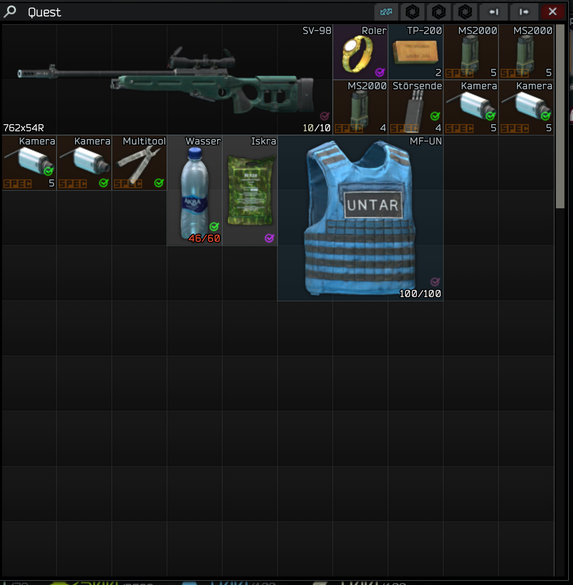

# AufgabenGepaeck (quest luggage)

Before the raid, packs the quest items of the selected map.

## How this mod was made (AI disclosure)

This mod was **programmed by Claude**, an AI assistant made by Anthropic.
**Kaan was the tester**: Kaan has no programming background, played with the mod
on SPT 4.1.6, reported what went wrong, and Claude fixed it. No human programmer
has reviewed the code. It is open source so anyone can check it — if you find a
bug, please open an [issue](https://github.com/Kaanori/spt-aufgabengepaeck/issues).

## Requirements

- SPT 4.1.6 (EFT 0.16.9). This mod has a client part and a server part; the ZIP contains both.

## Installation

1. Download `AufgabenGepaeck-1.3.0.zip` from the [Releases](https://github.com/Kaanori/spt-aufgabengepaeck/releases) page.
2. Extract it **into your SPT game folder** (the folder that contains `EscapeFromTarkov.exe`).
   The ZIP already has the right layout; the mod ends up in `BepInEx/plugins/` (client part) and `SPT_Runtime/user/mods/AufgabenGepaeck/` (server part).
   On Windows, make sure "Extract All" does not add an extra subfolder.
3. Restart the SPT server and the game.

## Uninstall

Delete the mod's files from `BepInEx/plugins/` (client part) and `SPT_Runtime/user/mods/AufgabenGepaeck/` (server part) (settings: `BepInEx/config/` for client mods) and restart the SPT server and the game.

## Version 1.3.0 (2026-11-03) - Quest Case

### What it is



The **Quest Case** is a new item for people whose secure container is always
full. It takes **2x2** cells in the secure container and holds one grid of
**10 x 30 = 300 cells** inside (configurable). It accepts everything **except
items that have grids of their own** (backpacks, rigs, cases, wallets, secure
containers, the Quest Case itself) - no storage inside storage.

When a Quest Case sits anywhere inside your secure container, Aufgaben-Gepaeck
packs the quest items for the selected map **into the Quest Case first**.
Without a Quest Case everything works exactly as before.

A 30-row grid does not fit on screen, so the Quest Case window **scrolls**:
mouse wheel (whole rows), a scroll bar on the right, and while dragging an
item the window scrolls by itself when you hold it at the top or bottom edge.
The game's own grid is kept as it is (any item size, drag and drop, sorting
button) - it is only shown through a clipping frame that moves it.

**Where to get it:** Therapist, loyalty level 1, 50,000 RUB (configurable).

### Two parts

| Part | File | Goes to |
|---|---|---|
| Client plugin | `bin/Release/netstandard2.1/AufgabenGepaeck.dll` | `BepInEx/plugins/` |
| Server mod (creates the item) | `Server/bin/Release/AufgabenGepaeckServer.dll` + `Server/questcase.json` | `SPT_Runtime/user/mods/AufgabenGepaeck/` |

The server mod clones the vanilla Ammunition case (2x2, its 3D model), gives
it the new grid and adds it to the grid filters of **every** secure container
(everything under the `MobContainer` class, including containers added by
other mods - done at server start and again on the first client request, after
all mods have loaded). Nothing in the database files is touched; all changes
happen in memory at runtime.

Fixed IDs (never change them, or bought cases disappear from the profile):
case `61afb620726b3782be0c8801`, trader offer `61afb620726b3782be0c8802`,
grid `61afb620726b3782be0c8803`.

### Settings

`questcase.json` (next to the server DLL, restart the server after changes):

| Key | Default | Meaning |
|---|---|---|
| `Breite` | 10 | grid width (cellsH), 1-20 |
| `Hoehe` | 30 | grid height (cellsV), 1-100 - only ever grow it while items are inside |
| `Haendler` | Therapist | trader id selling it |
| `Stufe` | 1 | loyalty level |
| `Preis` | 50000 | price in roubles |
| `BeimHaendler` | true | false = not sold at all |

F12 menu (BepInEx ConfigurationManager):

| Section | Setting | Default | Meaning |
|---|---|---|---|
| 2. Wohin | Quest Case zuerst | on | fill a Quest Case inside the secure container before anything else (independent of the "Sicherheitsbehaelter" switch) |
| 5. Quest Case | Fenster rollen | on | scrolling window; off = the game's full-height window |
| 5. Quest Case | Sichtbare Zeilen | 10 | max. visible rows (also capped to screen height) |
| 5. Quest Case | Zeilen je Mausrad-Raste | 2 | rows per mouse wheel notch |

### Also fixed in 1.3.0

Since SPT 4.1 the `conditions` of a quest in `quests.json` are an object
(`AvailableForStart` / `AvailableForFinish` / `Fail`) instead of a list. The
old parser expected a list, found no quest at all and therefore packed nothing
on 4.1.6. It now reads `AvailableForFinish` (and still accepts the old list).

### Removing the mod

Empty the Quest Case first. If the server mod is removed, SPT deletes the case
from the profile on the next start (`removeModItemsFromProfile`) - **including
everything inside it**.

### Credits

The idea of a case in the secure container with a scrollable window comes from
**Keymaster** by **LennoxP90** (MIT, "KM Case" / "KM Vault"). The code here is
written independently; unlike Keymaster's virtualised key rows, it keeps the
game's real grid so items of any size work.

## Version 1.2.0 (2026-09-19)

New setting **"Zuerst in den Sicherheitsbehaelter"** (first into the secure
container) (section `2. Wohin`, on by default). Previously the secure
container was at the end of the target list, so even with the container
allowed, quest items still ended up in the backpack as long as there was
room there. Now it is filled first, if allowed.

As a reminder: **the mod has no key.** It hooks into
`MatchMakerAcceptScreen.Show(...)` and packs automatically when the raid
confirmation screen opens.

## Version 1.1.0 (2026-09-19)

Fixed: in the "fehlt:" (missing:) messages the bare template ID was shown
instead of the item name, because `Aufgabenname()` simply returned
`bedarf.Vorlage`. There is no item object for missing things, so
`Anzeigename()` (which looks up `LocalizedName(Item)` via reflection) does
not apply.

New: `Gegenstandsnamen` reads `SPT/SPT_Data/database/locales/global/ge.json`
(falling back to `en.json`) at startup and resolves template IDs via the
keys `<id> Name`. Falls back to the ID if nothing is found.

## Origin

The source code was lost. This version was decompiled from
`BepInEx/plugins/AufgabenGepaeck.dll` (1.0.0) and rebuilt.
The original sits next to it as `AufgabenGepaeck.dll.original-1.0.0`.

Fixed up during decompilation:
- The iterator `AlleGegenstaende` could not be decompiled and was
  rewritten — it now goes through `CompoundItem` instead of the obfuscated
  `GClass3248`, which gets renamed with every EFT update.
- `[BepInDependency]` lost its arguments: back to `com.SPT.core`.
- Two `isinst` casts and `TryFindLocationForItem(..., ref)` -> `out`.

## Building from source

Needs the .NET 10 SDK and an SPT 4.1.6 installation to build against.

```bash
./build.sh             # Linux: build only
./build.sh --install   # build and copy into the game folder
```
```powershell
.\build.ps1            # Windows
.\build.ps1 -Install
```

The game folder is set in `Directory.Build.props` (Windows default `C:/SPT`)
or via the environment variable `SPT_DIR`.

## Support

Bugs and questions: [GitHub issues](https://github.com/Kaanori/spt-aufgabengepaeck/issues).

## License

MIT — see [LICENSE](LICENSE).
